<p align="center"><b>English</b> · <a href="README.fr.md">Français</a> · <a href="#summary">Summary</a> · <a href="#analysis">Results</a> · <a href="#1-why-this-database">Methodology</a></p>

# Materials Synthesis Routes Database — methodology of a multi-agent extraction and verification pipeline (v1)

<!-- SITE:visual:begin -->
<p align="center"><picture><source media="(prefers-color-scheme: dark)" srcset="docs/img/accueil/pipeline_en_dark.svg">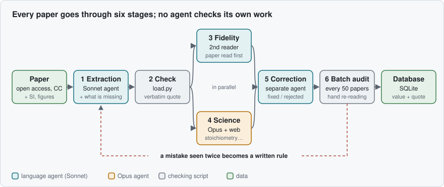</picture></p>

<p align="center"><picture><source media="(prefers-color-scheme: dark)" srcset="docs/img/accueil/chiffres_en_dark.svg">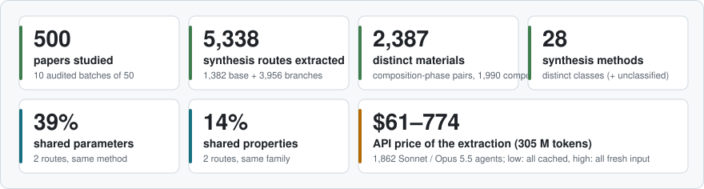</picture></p>

<sub>Materials: distinct (composition, phase) pairs, device routes excluded. Shared parameters and properties: mean Jaccard similarity between two base routes of the same method (or family), on the canonical vocabulary. Price: full history of <code>audits/jetons.csv</code> (every agent) at list API rates; the log does not split input, output and cache, hence the range; the orchestrator and the blind re-extraction are not counted. Computed by <code>analyses/chiffres_accueil.py</code>.</sub>

## The data model

A **base route** holds a full protocol; each **branch** is a variant tested by the authors and stores only what changes. Every value comes with its verbatim quote, and what the paper leaves out is recorded.

<p align="center"><picture><source media="(prefers-color-scheme: dark)" srcset="docs/img/accueil/modele_en_dark.svg">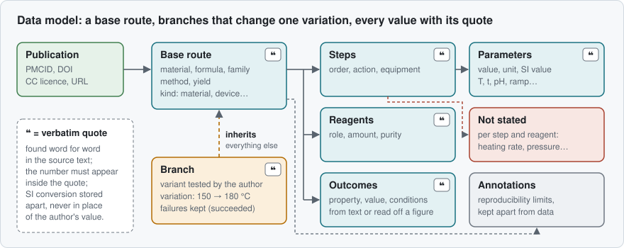</picture></p>

## An example

<p align="center"><picture><source media="(prefers-color-scheme: dark)" srcset="docs/img/accueil/exemple_en_dark.svg">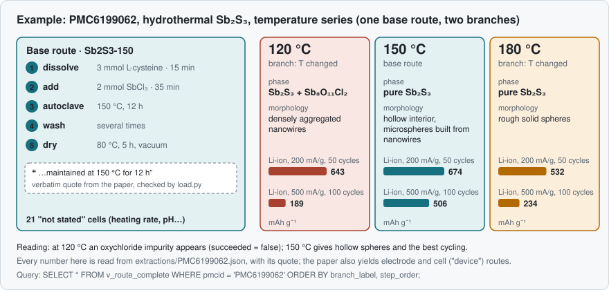</picture></p>

## The database at a glance

<table>
<tr><td width="50%" valign="top"><picture><source media="(prefers-color-scheme: dark)" srcset="docs/img/accueil/carte_familles_en_dark.svg">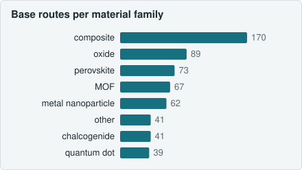</picture><br><sub>747 material base routes, 17 families</sub></td><td width="50%" valign="top"><picture><source media="(prefers-color-scheme: dark)" srcset="docs/img/accueil/carte_methodes_en_dark.svg">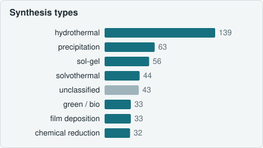</picture><br><sub>top 8 of 29 classes (method keywords)</sub></td></tr>
<tr><td width="50%" valign="top"><picture><source media="(prefers-color-scheme: dark)" srcset="docs/img/accueil/carte_essentiels_en_dark.svg">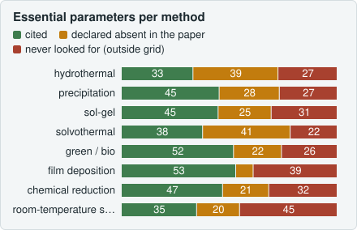</picture><br><sub>green: cited · amber: paper silent · red: outside the grid</sub></td><td width="50%" valign="top"><picture><source media="(prefers-color-scheme: dark)" srcset="docs/img/accueil/carte_trous_en_dark.svg">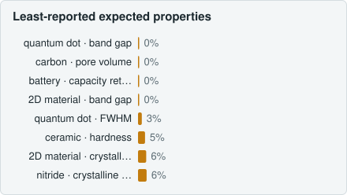</picture><br><sub>share of the family&#x27;s routes reporting the property</sub></td></tr>
<tr><td width="50%" valign="top"><picture><source media="(prefers-color-scheme: dark)" srcset="docs/img/accueil/carte_branches_en_dark.svg">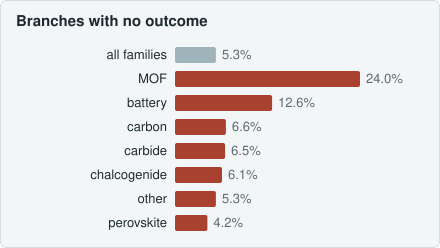</picture><br><sub>tested variants with no outcome or characterization, %</sub></td><td width="50%" valign="top"><picture><source media="(prefers-color-scheme: dark)" srcset="docs/img/accueil/carte_mecanismes_en_dark.svg">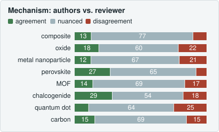</picture><br><sub>512 routes: authors&#x27; mechanism judged by the reviewer</sub></td></tr>
<tr><td width="50%" valign="top"><picture><source media="(prefers-color-scheme: dark)" srcset="docs/img/accueil/carte_limites_en_dark.svg">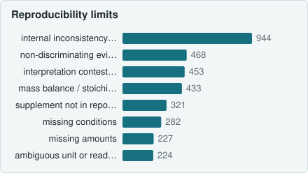</picture><br><sub>83% of base routes carry at least one limit</sub></td><td width="50%" valign="top"><picture><source media="(prefers-color-scheme: dark)" srcset="docs/img/accueil/carte_references_en_dark.svg">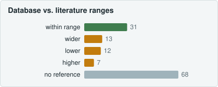</picture><br><sub>31 of 131 pairs within the published range</sub></td></tr>
<tr><td width="50%" valign="top"><picture><source media="(prefers-color-scheme: dark)" srcset="docs/img/accueil/carte_aveugle_en_dark.svg">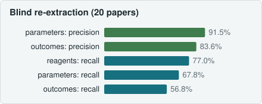</picture><br><sub>20 papers re-extracted without seeing the database</sub></td><td width="50%" valign="middle"><sub>Detailed figures, method and limits: collapsible sections below, reports <code>audits/audit_contenu.md</code> and <code>audits/audit_verification.md</code>.</sub></td></tr>
</table>

<!-- SITE:visual:end -->

> **Data.** The `synthese.db` SQLite database is attached to the [v1.0](https://github.com/TerryChauvin/synthgraph-db/releases/tag/V1.0) release. This repository holds the JSON extractions, critiques, decision logs, audit reports, article texts (`corpus/`, under each article's own licence) and the code.


`synthese.db` (SQLite) gathers materials synthesis routes extracted from open access articles. **Every value carries the verbatim quotation from the article** that supports it and its position in the text, and what the article does not say is recorded. This document describes **version 1** of the database in the manner of a "Materials and Methods" section: where the articles come from, how they are turned into data, how the agent pipeline works, when an extraction is judged good, what the database contains, what it lacks, and the planned next step (v2).

Status as of 30 October 2026: 500 publications closed and audited (ten batches of 50). The figures come from `synthese.db` (read-only queries) and from the reports in `audits/`.

---

## Summary

**Objective.** To allow a chemist to remake a material from the database alone, and to see how each synthesis variation tested by the authors changes the result.

**Materials.** 500 original full-text, open access articles (Creative Commons licences), drawn from Europe PMC, a public database of scientific literature: 69 journals, published from 2009 to 2026.

**Method.** Each article goes through a six-step pipeline run by language agents with separate roles: extraction, automatic quote check, review, two independent critiques (fidelity to the text, scientific plausibility), correction, then an audit every 50 articles. No agent checks its own work, and the text of the article settles any disagreement.

**Results.** 5,338 synthesis routes (1,382 base routes, 3,956 branches), 2,387 distinct materials, 28 method classes. 95,053 quotes verified word for word (100%); 11,285 values reread by hand, 16 of them wrong, all corrected; a blind re-extraction of 20 publications recovers 91.5% of the parameters with no conflict on the values.

**Limits.** The database is faithful but heterogeneous: two routes of the same method share on average only 39% of their parameters, and two routes of the same family 14% of their properties. Characterisation conditions are often missing and the v1 verification grid is too short.

**Next step (v2).** A strict grid of parameters per method and per characterisation technique, and an adaptive vocabulary applied from the extraction onward.

---

## 1. Why this database

The literature on materials synthesis is abundant but hard to reuse. Conditions are scattered across Methods, Results, tables, captions and supplementary information. Series of compared samples are described by sentences such as "the same procedure was repeated at 150 and 180 °C". Gaps (the amount of a reagent, the atmosphere of an anneal) are not flagged. A chemist who wants to remake a material has to reread the whole article and guess the rest.

The database answers two questions for each article:

1. **What exactly does the article say** for each reagent, each step, each parameter, each result, and each compared variant?
2. **What does it not say**, and what, in what it does say, is inconsistent or doubtful to a trained reader?

Target of v1: 500 publications, processed in batches of 50 audited publications.

## 2. Where the articles come from: Europe PMC

### 2.1 A public database of scientific literature

[Europe PMC](https://europepmc.org) is a free public repository of literature in the life sciences and neighbouring disciplines: articles, preprints, books, theses.

| | |
|---|---|
| Operated by | the European Bioinformatics Institute (EMBL-EBI, Hinxton, United Kingdom), in partnership with the National Library of Medicine's PubMed Central (United States), within the PubMed Central International network |
| Since | 2007 (successor to UK PubMed Central and CiteXplore) |
| Funded by | the Europe PMC funders' group (36 European research organisations, including the Wellcome Trust and the European Research Council), which make it the mandatory repository for the publications they fund; recognised as a "Core Data Resource" by ELIXIR |
| Volume | more than 46 million abstracts; about 12.4 million full-text articles, of which about 8.4 million in the open access subset (figures from the website, October 2026) |
| Activity | open access subset updated every week; the share of freely accessible articles grows every year (nearly 58% of 2025 articles, against less than 10% for 2005); more than 32 million distinct IP addresses visited it in 2023 |

**Who publishes there.** Nobody publishes directly in Europe PMC. Publishers deposit the full text of their journals there (via PubMed Central), authors deposit their accepted manuscript when their funder requires it, and preprint servers are indexed. Materials chemistry enters mainly through multidisciplinary open access journals. In our corpus: RSC Advances (77 publications), Scientific Reports (63), Nanomaterials (49), Materials (48), Molecules (27), Nanoscale Research Letters (24), ACS Omega (20).

**Why this database.** It provides the full text as structured XML (JATS format: sections, tables, captions, bibliography), the licence of each article, and a free programming interface. Its counterpart: a biomedical orientation (§ 14.4).

### 2.2 Selection of the articles

- **Filter** added to every query (`fetch.py`): `OPEN_ACCESS:y AND IN_EPMC:y AND HAS_FT:y NOT PUB_TYPE:review`, that is original, full-text, open access articles.
- **Queries**: one per materials family (`queries.txt`: MOFs and ZIFs, metal nanoparticles, oxides, perovskites, zeolites and mesoporous silicas, chalcogenides and phosphides, carbons, electrode materials, ceramics, 2D materials, quantum dots). They target articles that **compare synthesis conditions** ("effect of", "optimization", "synthesis conditions"), because these are the ones that carry branches.
- **Licences**: only Creative Commons licences are retained. Of the 500 publications: 366 CC BY, 88 CC BY-NC, 45 CC BY-NC-ND, 1 CC BY-NC-SA. The text in `corpus/` remains under the licence of each article; any reuse must respect it.
- **Rejections**: an article without a usable synthesis (off topic, simulation, protocol entirely referred elsewhere) is discarded at extraction, with its reason written down (13 rejections out of 513 articles processed).

### 2.3 Status of the articles: data, not instructions

Articles, supplementary files and web pages are **untrusted data**. They are read by libraries, never executed; Python is run in isolated mode (`-I`); every agent is instructed to follow no instruction that these texts might contain. An article must not be able to influence how it is read.

## 3. How an article becomes data

### 3.1 Converting the article: why and how

**Why convert.** The central rule of the database is that a value exists only if its quote is found **verbatim** in the article. For this check to be mechanical, the agent that reads and the script that verifies must have **the same document in plain text** before them, where every passage has a fixed position. The PDF loses the structure (columns, tables, superscripts); the JATS XML keeps it. Each type of content is therefore converted according to its role:

| Article content | Conversion | Tool | Why |
|---|---|---|---|
| **Text** (sections) | JATS XML → plain text split by sections | `sections.py` → `corpus/text/<PMCID>.txt` | single reference document: all quotes and positions (`char_start`, `char_end`) refer to it |
| **Tables** | one row per line, cells separated by ` \| ` | `sections.py` | one quote = one row = one sample; the row is attributed by the sample name, never by its position |
| **Captions, table notes** | appended at the end of the file | `enrich.py` | captions often carry the measurement conditions and the sample names |
| **Supplementary information** | text extracted from the PDF and Word files of the PMC repository, appended at the end of the file | `enrich.py` | exact quantities and sample series are often there; 68 publications cite a supplementary file absent from the repository (§ 14.4) |
| **Figures** (images) | downloaded as they are | `enrich.py figs` → `corpus/fig/<PMCID>/` | read by the agent only when a result exists only in the image; value marked `from_figure`, quote = the caption (6,997 results out of 39,350) |
| **References** | text with `[[id]]` cross-references and bibliography | `enrich.py` → `corpus/refs/<PMCID>.txt` | a "prepared as described in [12]" becomes a method source whose identifier is checked against the bibliography |

Additions are **always made at the end of the file**, so as not to shift any quote already extracted (2,709 positions rechecked during the audit of the pipeline on 12 October). `enrich.py` is idempotent: rerun on an article already enriched, it produces the same file.

### 3.2 Routes, branches, variations

- A **base route** describes a complete protocol: target material, method, reagents, ordered steps with their parameters and equipment, characterisations, results, yield.
- A **branch** is a variant compared by the authors. It inherits the reagents and steps of its parent and declares **what changes and relative to what** (`route_variations`: parent value, branch value, quote). The SQL views (`v_route_complete`, `v_branches`, `v_comparaison`) reconstruct the complete protocol of any branch.
- **Failed attempts** are branches like any other (`succeeded = false`).
- **Tests of the finished material** (cycling, cytotoxicity, catalyst dose) are results, not branches. A post-treatment that transforms the material is a `post_treatment` route; the fabrication of an electrode, a cell or an LED is a `device` route.

Over 500 publications: 1,382 base routes, 3,956 branches, 5,594 variations, 7,714 reagents, 9,546 steps, 12,731 parameters, 39,350 results, 9,083 characterisations.

### 3.3 Traceability of each value

| Column | Content |
|---|---|
| `quote` | passage copied word for word from the plain text (°, ·, −, subscripts included), long enough to be unambiguous, a single row for a table |
| `char_start`, `char_end` | position of the passage in `corpus/text/<PMCID>.txt` |
| `value_num` + `unit` or `value_text` | the value as written; "room temperature", "overnight" remain text |
| `value_si`, `unit_si` | SI conversion done by `load.py`, in a separate column, never in place of the original value |
| `from_figure` | for a value read from an image: the figure and the panel |

Two structures make **absence** explicit:

- `not_stated` (28,631 cells across the closed publications): every item of the reproducibility grid (§ 4.2.1) is **either extracted with its quote, or declared not stated** after a search of the whole article.
- `doubts` (6,761): every ambiguity that affects a datum or the split into branches, with the possible readings and the reading retained, settled by the orchestrator.

### 3.4 Data and interpretations

The **annotations** (10,582, in French, `source = 'claude'`) are interpretations kept separate from the data: summary, objective, conclusion of the authors, comparison of the branches, mechanism, safety, and **reproducibility limit** (4,558): everything a chemist must know before repeating the synthesis. An annotation that reports the authors requires a quote; an analysis annotation has none, so that the two are never confused.

The **method sources** (1,052) list the bibliographic references needed to repeat a preparation ("according to", "as described in", "modified … method").

## 4. The pipeline: who does what

### 4.1 The pipeline in plain terms

<p align="center"><picture><source media="(prefers-color-scheme: dark)" srcset="docs/img/accueil/pipeline_en_dark.svg"></picture></p>

The pipeline works like an analytical laboratory in which each sample passes through several hands:

1. **A reader extracts** the article: they note every reagent, every step, every result, with the sentence of the article that states it, and the list of what the article does not say.
2. **A machine checks** that every quoted sentence really exists, verbatim, in the article.
3. **A supervisor reviews** the doubtful points, and one record in five in full.
4. **Two independent experts** review: one checks that nothing was miscopied or forgotten, the other that the chemistry described by the authors holds together.
5. **A corrector** applies the supervisor's decisions.
6. **An audit** rechecks the whole batch every 50 articles before moving to the next.

### 4.2 The pipeline in detail: instructions and verification rules

<p align="center"><picture><source media="(prefers-color-scheme: dark)" srcset="docs/img/accueil/pipeline_detail_en_dark.svg">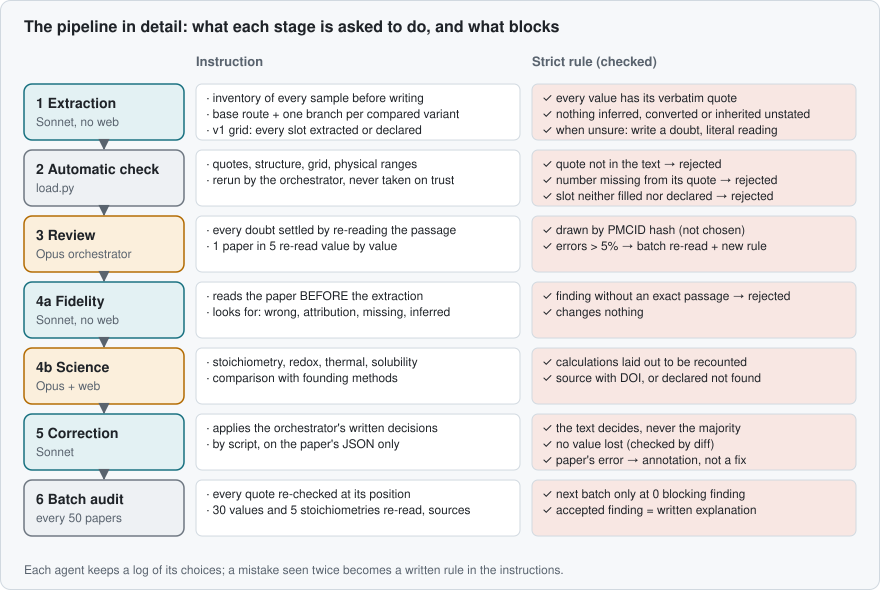</picture></p>

Each agent receives written, versioned instructions (`methodologie/RUNBOOK.md`, `methodologie/CRITIQUE.md`, `methodologie/PLAUSIBILITE.md`, `methodologie/PROMPT_CORRECTION.md`). It writes a **decision log** (`journaux/<PMCID>_<passe>.md`, 10 to 30 lines on its non-obvious choices). No agent is taken at its word: the orchestrator reruns the checks itself and reads only the products (JSON, log, short report).

#### 4.2.1 Extractor (`methodologie/RUNBOOK.md`)

Absolute rules:

1. Every datum carries its exact quote.
2. Nothing invented, deduced or converted; an absent value stays absent and goes into `not_stated`.
3. All compared variations become branches, failures included; Results and tables are read, because series are often defined there.
4. When in doubt, do not decide: write the doubt and extract the most literal reading.
5. No usable synthesis → reasoned rejection.

**Inventory before writing.** Before any route, the extractor lists **all named or compared samples**: where each is defined, what distinguishes it, where its results are. One table row = one sample, attributed by its name; with "respectively", the order is written out before any attribution. This rule comes from the three most frequent errors of the first batch (value placed on the wrong sample, step inherited without the article saying so, forgotten branch).

**v1 checklist (reproducibility grid).** For each element, each expected item is either extracted with its quote or declared "not stated"; `load.py` refuses any cell that is neither filled nor declared, or both at once. It is a short list, defined by **step type** and not by synthesis method:

| Element | Expected items |
|---|---|
| Base route | yield |
| Reagent (except washing, gas, substrate) | amount, purity, supplier |
| Heating, reaction, reflux, ageing | temperature, duration |
| Calcination, annealing, sintering, pyrolysis | temperature, duration, atmosphere, heating rate |
| Drying | temperature, duration |
| Stirring, mixing, ultrasonication, dispersion | duration |
| Centrifugation | speed, duration |
| Washing | solvent, number of washes |
| pH adjustment | pH |

The extractor may add any other missing item (stirring speed, cooling, fill ratio…), but without obligation: this is the main weakness of v1 (§ 8).

**Supplementary information, figures, references.** The extractor reads captions, table notes and supplementary files in full. A value that exists only in a figure is read from the image (two significant figures at most) and marked `from_figure`. A protocol referred to another publication becomes a method source, never a value completed from memory.

#### 4.2.2 Automatic check (`load.py`)

`load.py check` refuses the extraction if a rule is violated; `load.py load` loads only at zero errors. These checks are **invariants**: they are never weakened to get an extraction through.

| Family | Strict rule |
|---|---|
| Quote | present, long enough, **found as is in the plain text**; for each number and each reagent amount, **the number appears in its quote** (1,5 / 1.5 / 1·5 recognised), except for a value read from a figure |
| Structure | unique labels; existing parents, no cycle; a branch declares at least one variation; steps numbered without gaps |
| Grid | each cell of the v1 list extracted or declared, never both |
| Values | unit for a number; pH between 0 and 14; positive duration; physically possible temperature |
| Annotations and sources | mandatory annotations present; quote required when reporting the authors; each cross-reference exists in the bibliography |

A self-test verifies that each faulty case (altered quote, missing number, branch without variation, impossible pH, forgotten cell) is indeed refused.

#### 4.2.3 Orchestrator review

- **Always**: every doubt is settled by rereading the passage, with the resolution written down; the presence of all branches is checked by going through tables and Results row by row.
- **Full review** (every value compared with the article: value, unit, step, branch, quote) of the first 10 publications, then of **one publication in five drawn by the SHA-1 hash of its identifier**: the draw is deterministic and cannot be chosen.
- **Threshold**: if more than 5% of the values reread are wrong, the whole batch is reread and the rule that prevents the error is added to the instructions.

#### 4.2.4 Fidelity critique (`methodologie/CRITIQUE.md`)

A second agent reads **the article before the extraction**, draws up its own list of samples, then looks, in order of importance, for: wrong value, wrong attribution, missing or invented branch, wrongly "not stated", deduced value presented as quoted, badly split step, missing method source, unfaithful annotation. Each finding carries a severity, a certainty and **what the article says as an exact quote**: `critic_load.py` refuses a finding whose quote is not in the text. This critic has no web access and modifies nothing.

#### 4.2.5 Scientific critique (`methodologie/PLAUSIBILITE.md`)

A third agent judges the **authors' protocol**, route by route: temperature against vessel (boiling point, autoclave), amounts converted to moles and compared with the target formula, derived quantities recalculated (Bragg, Scherrer, yield), physical vocabulary, control that changes several variables, consistency between sections, discriminating evidence, unwritten safety. Three rules make it checkable:

- **calculations laid out** (inputs, formula, result, source of each constant) so that they can be recounted;
- **verifiable sources** (title, authors, year, DOI); a reference that cannot be found is declared, never invented;
- **library before the web**: `references/fondateurs.md` (founding papers by family, DOIs verified on Crossref) and `references/constantes.md`; about ten web searches per article at most.

Each route receives a verdict (consistent, doubtful, inconsistent, unverifiable) and the list of what a chemist should check.

#### 4.2.6 Correction

The orchestrator fixes in writing, finding by finding, what is corrected or rejected:

- **the text settles, never the majority**;
- internal contradiction of the article: the literal value of the table is kept, the other is flagged;
- no unfounded inheritance;
- **problems that come from the article become "reproducibility limit" annotations, never corrections**: the database does not repair an article.

An agent applies these decisions **by script**, on the sole JSON file of the publication. The orchestrator then checks that no value has been lost (`diff_valeurs.py`), reruns `load.py`, checks a few additions against the text and records the status of each finding.

#### 4.2.7 Closure and backup

A publication is closed when its two critiques have been processed. Each load and each closure is a pushed git commit: the history of each value (extraction, correction, reason) can be consulted.

### 4.3 Choice of models

The models were chosen on a pilot, then confirmed by the measurements of the first batches, according to three criteria: **accuracy of copying** on long texts with special characters, chemical **reasoning ability**, and **cost per publication**.

| Role | Model | Effort | Why |
|---|---|---|---|
| Orchestrator | Opus | high | arbitration, rereading against the text, splitting into branches; a medium effort let wrong attributions through |
| Extraction | Sonnet | high | exhaustive reading (supplementary files, tables) and word-for-word quotes; a lower effort skipped cells of the grid |
| Fidelity critique | Sonnet | high | same requirement of complete reading; **same model as the extractor, deliberately**: what is sought is the independence of the reading (article read first), not a difference of model |
| Scientific critique | Opus | high | chemistry reasoning, stoichiometry, search for sources |
| Correction | Sonnet | high | targeted reading and application by script |

Ruled out: **Haiku** (too many copying errors on long texts with special characters), **Fable** (2.5 times the price of Opus with no measured gain on these tasks), the "very high" and "maximal" efforts (cost with no gain observed on the pilot). Measured cost: about 0.9 M tokens per publication in the first batch, then 0.6 to 0.7 M, spread roughly equally between extraction, fidelity critique, scientific critique and correction.

## 5. When is an extraction judged good and valid?

### 5.1 Validity criteria

In this pipeline, an extraction is declared **valid** when all the following conditions are met, in order:

1. `load.py check` returns **zero errors**: every quote is found verbatim, every number appears in its quote, every cell of the grid is extracted or declared.
2. **Every doubt is settled**, with its resolution written down.
3. The **fidelity critique** is done and each of its findings has a status: corrected, rejected with a reason, or accepted with an explanation.
4. The **scientific critique** is done; problems coming from the article are rendered as reproducibility limits.
5. The **correction** is verified: no value lost, reload at zero errors, additions checked against the text.
6. The publication is **closed** and saved.

Then, at the scale of the batch of 50 publications:

7. The audit returns **zero blocking anomalies**, and each warning is dealt with by going back to the article (corrected, or accepted with a written explanation).
8. The **error rate of the full reviews** stays below 5%; beyond that, the whole batch is reread.

"Valid" means **faithful to the article and explicit about its gaps**. It does not mean that the protocol works:

| Level | Claim | How it is established | Degree |
|---|---|---|---|
| **Fidelity** | "The database says what the article says." | exact quote and position; second reader on 100% of the publications; full review of one in five | **measured** (§ 5.3) |
| **Completeness** | "The database says what is useful in what the article says, and declares the rest." | reproducibility grid, sample inventory, "missing" findings of the critic | **checked**, with no guarantee of exhaustiveness (§ 14) |
| **Consistency** | "What the article says holds physically and chemically." | automatic tests; sourced scientific critique | **sourced opinion**, inconsistencies reported without correction |
| **Experimental validity** | "The protocol yields the described material." | — | **not established**: only a laboratory reproduction can say |

### 5.2 Batch audit checks

Every 50 articles, `audit.py N` reruns checks over the whole batch and writes `audits/palier_NNN.md`:

| Family | Check | Severity |
|---|---|---|
| Quote | each quote reread **at its position** in the text; absent → blocking; number absent from its quote → blocking | blocking / warning |
| Physics | inconsistent SI value; pH outside 0–14; temperature above the solvent's boiling point without autoclave or reflux; duration of more than 30 days | blocking / warning |
| Chemistry | each element of the product must come from a reagent; atmosphere consistent with the oxidation state | warning / information |
| Consistency | mandatory annotation absent; unsettled doubt; branch without variation; due review not done | blocking / warning |

Manual checks are added: 30 values drawn at random (fixed seed) reread one by one; stoichiometry of 5 routes recalculated; syntheses of the same material compared across publications (`compare.py`); a sample of the scientific critic's sources opened and verified (an invented source is a blocking anomaly). Each batch has its review report (`audits/palier_NNN_relecture.md`), which also states **what was not verified**.

### 5.3 What the checks measured over the 500 publications

| Check | Result |
|---|---|
| Quotes verified at their position | 95,053, **100% exact** |
| Full reviews | 11,285 values reread, 16 wrong, all corrected: 10 in the calibration publications (1.6%), then 6 out of 10,724 (0.06%) |
| Fidelity critique | 4,345 findings: 4,157 corrected, 169 rejected with a reason, 19 accepted; 90 classed "wrong" |
| Doubts | 6,761, settled with a written resolution (15 still open) |
| Scientific critique | 2,983 routes judged: 1,149 consistent, 1,493 doubtful, 108 inconsistent, 233 unverifiable; problems rendered in 4,558 reproducibility limits, no value changed |
| Batch audits | 0 blocking anomalies over the ten batches; warnings mostly false positives of the chemistry check, each accepted with its reason |

The "doubtful" verdict mostly covers reservations (information missing to conclude, control with several variables). The problems come from the articles, not from the extractions: a cobalt content higher than that of pure cobalt, a "HeNe laser at 532 nm", an aqueous dispersion "stirred at 350 °C".

### 5.4 Continuous improvement

An error seen twice becomes a rule written in the instructions, with its date. Since the instructions are versioned, the state of the rules at the time each publication was processed can be reconstructed. This is how the error rate went from 1.6% at calibration to 0.06% afterwards.

## 6. Cleaning the database

Five hundred publications read by different agents produce a free vocabulary: the same parameter or the same property bears different names from one article to another, and the method is a sentence. To compare routes with one another, the database was cleaned **after the fact**, without touching the values.

### 6.1 Too many names: a canonical vocabulary

`canon.py` associates with each name written by an extractor a **canonical name** and a group, in separate columns (`parameters.name_canon`, `outcomes.property_canon`, `outcomes.property_group`); the original names remain intact.

| | Occurrences | Names written | Canonical names | Unclassified |
|---|---|---|---|---|
| Step parameters | 12,731 | 682 | 37 | 0.9% |
| Measured properties | 39,350 | 16,577 | 95 | 9.1% (25.8% before) |

Examples: `temperature_final`, `temperature_initial`, `temperature_start` → `temperature`; 62 duration names → `duration`. Full correspondence table: `docs/vocabulaire/`.

### 6.2 Merged methods

The method is written as free text ("template-free hydrothermal reaction at 150 °C"). A keyword table sorts it into **28 classes** (hydrothermal, precipitation, sol-gel, solvothermal, green route, film deposition, chemical reduction…), plus an "unclassified" class (43 base routes). A second, independent classification, drawn from the sequence of steps, agrees with the first for **68.8%** of the routes.

### 6.3 Duplicates and units

45 materials appear under several names and 88 unit variants were found; 71% of the numerical parameters have an SI value (temperature, duration and ramp at 99%; never volumes, concentrations and speeds, a limit of `load.py`).

### 6.4 What the cleaning does not do

It changes no value, merges no route, and its rules can be regenerated (`python3 -I canon.py apply`). It is a cleaning by regular expressions, applied after the extraction: it leaves 9.1% of the properties without a class (§ 8).

<!-- SITE:analysis:begin -->
<a id="analysis"></a>

## 7. What the database contains: results

Two content audits (28 October 2026) examine what the 500 papers actually contain and whether the extraction can be trusted. Everything is reproducible: `python3 -I analyses/audit_contenu.py`, `audit_parametres.py`, `audit_verification.py`, `compare_blind.py`, then `build_site.py` for this page.

| **747** | **29** | **96** | **83%** | **512** | **20** |
|---|---|---|---|---|---|
| material base routes | method classes | canonical properties (from 16,577 names) | of base routes with a limit | mechanisms compared | papers re-extracted blind |

<details><summary><b>1. What the database contains</b></summary>

<p align="center"><picture><source media="(prefers-color-scheme: dark)" srcset="docs/img/familles_en_dark.svg">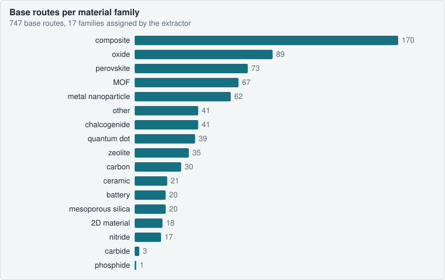</picture></p>

<p align="center"><picture><source media="(prefers-color-scheme: dark)" srcset="docs/img/methodes_en_dark.svg">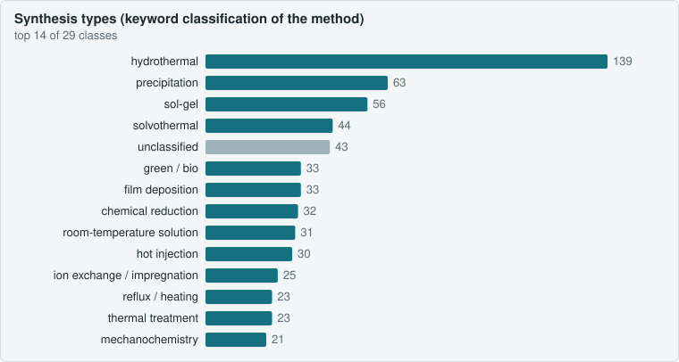</picture></p>

- **Hydrothermal dominates** (18.6% of base routes), then precipitation, sol-gel and solvothermal. Two independent classifications (method keywords, step sequence) agree on **68.8%**.
- The 16,577 free property names are mapped to **96 canonical properties** by a regex table; **9.1% of values** stay unclassified (names too specific). A closed vocabulary is needed before any statistical use.

</details>

<details><summary><b>2. Common and essential parameters</b></summary>

<p align="center"><picture><source media="(prefers-color-scheme: dark)" srcset="docs/img/essentiels_en_dark.svg">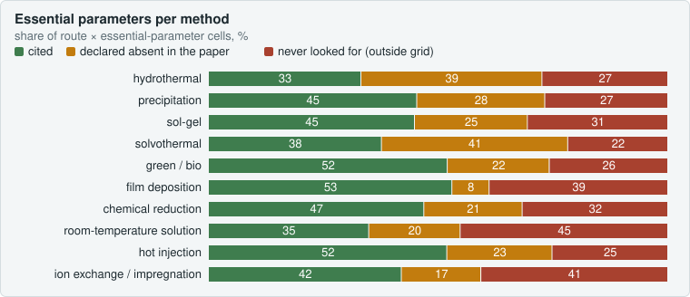</picture></p>

- **Temperature and duration are the only universal parameters** (90–100% of routes of the main methods). Beyond that, two routes of the same method share only 25–45% of their parameter types (Jaccard similarity 0.19–0.43).
- **Papers are the first source of gaps.** For autoclave methods, 39% of essential parameters are not given by the paper (and the extractor said so); fill fraction is cited in 1–5% of routes, heating and cooling rates in under 12%.
- **The extraction has blind spots**: cooling rate, gas flow, cycle repeats, power and fill fraction are not in the reproducibility grid, so they are neither cited nor declared absent.
- Precursor amounts, by contrast, are given for 87% (hydrothermal) to 97% (green routes) of precursors and declared absent when missing: no silent gaps.

</details>

<details><summary><b>3. Coverage gaps</b></summary>

<p align="center"><picture><source media="(prefers-color-scheme: dark)" srcset="docs/img/trous_en_dark.svg">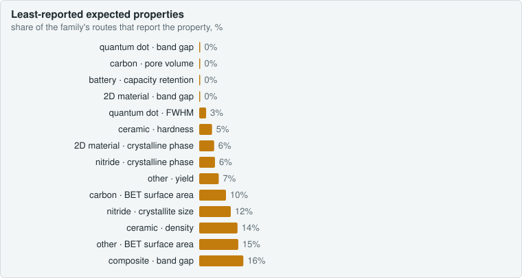</picture></p>

- **132 family × method cells out of 175** hold fewer than 5 routes: beyond hydrothermal and sol-gel, each method is represented by a handful of routes per family (electrochemistry: 4 routes in total).
- **43 expected family-property pairs** are covered below 30%: band gap and quantum yield of perovskites, BET area of carbons, capacity retention of batteries, density and hardness of ceramics.
- Under-represented families: carbides (3 routes), phosphides (1), nitrides (17), 2D materials (18). Missing or buried in "other": polymers, glasses, alloys, COFs, solid electrolytes, thermoelectrics.

</details>

<details><summary><b>4. Data quality</b></summary>

<p align="center"><picture><source media="(prefers-color-scheme: dark)" srcset="docs/img/branches_en_dark.svg">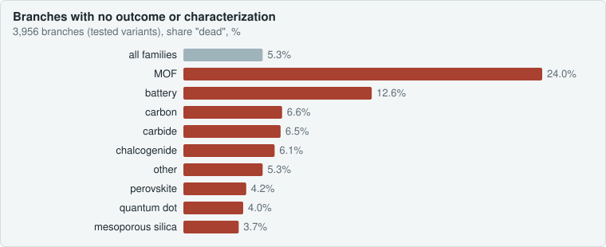</picture></p>

- **Branches**: 5.3% with neither outcome nor characterization, but 24% among MOFs (condition series for which the paper reports a single global result).
- **Nominal stoichiometry**: of 60 checkable routes, 24 match the product formula within 10%; large gaps are intended excesses or precursors supplied by an intermediate route, not errors.
- **8 out-of-range values**, all copied from the papers (quantum yields of 112–241% for carbon dots, measured against a standard).
- **Normalization**: 682 parameter names for 27 types; 71% of numeric parameters have an SI value (temperature, duration, ramp at 99%; never volumes, concentrations, speeds: a `load.py` limit).
- **Variation → effect**: 61% of 3,064 numeric variations have a property measured on both sides; 693 series of 3+ points, 56% monotonic. A temperature change shifts size and texture properties by 40–50% (median), a reagent change shifts optical properties by under 10%.

</details>

<details><summary><b>5. Reproducibility limits and mechanisms</b></summary>

<p align="center"><picture><source media="(prefers-color-scheme: dark)" srcset="docs/img/limites_en_dark.svg">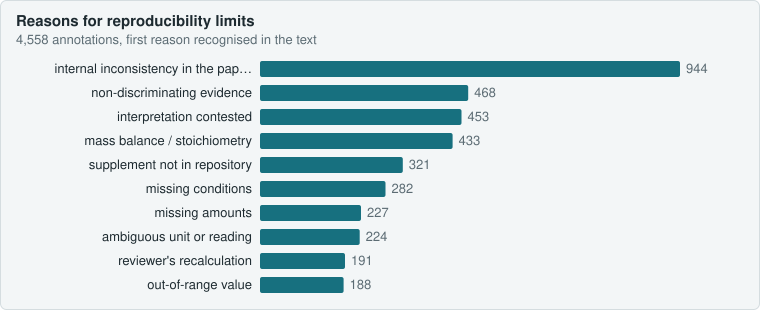</picture></p>

<p align="center"><picture><source media="(prefers-color-scheme: dark)" srcset="docs/img/mecanismes_en_dark.svg">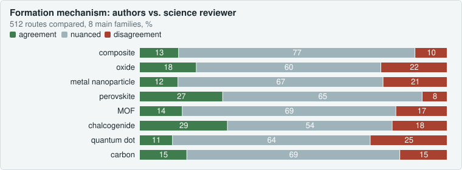</picture></p>

- **83% of base routes** carry at least one limit; the first cause is internal inconsistency in the paper (21%), ahead of non-discriminating evidence (10%), contested interpretation (10%) and impossible mass balances (9.5%).
- Over 512 routes, the authors' mechanism and the science reviewer's are in **agreement for 83**, **nuanced for 346** (including 106 papers that describe no mechanism) and in **disagreement for 83**; **25** mechanisms are contradicted by the extracted conditions (reduction without a reductant, AgCl precipitating before any reduction…).
- Foundational works most often missing though they ground the method: Iravani 2011 (29), Cundy & Cox 2003 (16), Essner et al. 2018 (15).

</details>

<details><summary><b>6. Comparison with the literature</b></summary>

<p align="center"><picture><source media="(prefers-color-scheme: dark)" srcset="docs/img/references_en_dark.svg">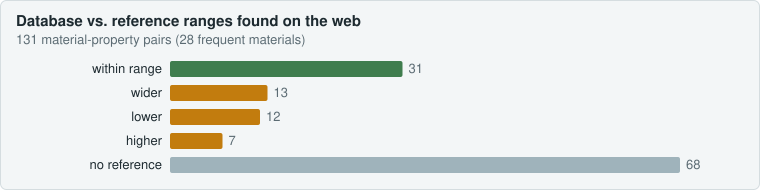</picture></p>

- Of 131 material-property pairs, 31 fall within the published range. Clear deviations: SnS band gap (median 2.81 eV vs. 1.07–1.40 eV bulk), CdS photoluminescence (580 nm vs. 490–505 nm: trap emission), "mesoporous" silicas (BET 274 vs. 400–1,137 m²/g), ZIF-8 micropore volume (0.15 vs. 0.52–0.62 cm³/g).
- Structured databases (CoRE MOF, IZA, Materials Project) are not reachable from the execution environment; ranges come from the web, with the URL actually consulted.

</details>

<details><summary><b>7. Verification by blind re-extraction</b></summary>

<p align="center"><picture><source media="(prefers-color-scheme: dark)" srcset="docs/img/aveugle_en_dark.svg">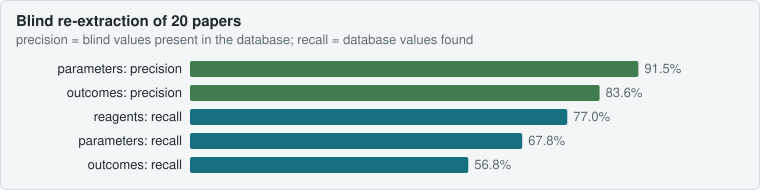</picture></p>

- 20 randomly drawn papers were re-extracted by an agent that saw neither the database extraction nor the critiques: 167 of 172 routes matched. **91.5% of parameters and 83.6% of outcomes** found blind are in the database, with **0 conflict** on unambiguous values.
- The lower recall (68% of parameters, 57% of outcomes) measures what the critiques add: the database holds about 30% more parameters and 40% more outcomes than a single extraction. Remaining disagreements are attributions of a value to another sample or route.

</details>


### Full reports

- [audits/audit_contenu.md](https://github.com/TerryChauvin/synthgraph-db/blob/main/audits/audit_contenu.md) — synthesis types, properties, conditions, gaps, quality, mechanisms, references
- [audits/audit_verification.md](https://github.com/TerryChauvin/synthgraph-db/blob/main/audits/audit_verification.md) — parameters per method and seven verification checks
- [audits/palier_010_relecture.md](https://github.com/TerryChauvin/synthgraph-db/blob/main/audits/palier_010_relecture.md) — latest batch audit

<!-- SITE:analysis:end -->

### In summary: the key figures of v1

| | |
|---|---|
| Publications studied | 500 |
| Synthesis routes extracted | 5,338 (1,382 base routes, 3,956 branches) |
| Distinct materials (composition-phase pairs) | 2,387, across 1,990 compositions |
| Synthesis methods | 28 classes |
| Parameters shared between two routes of the same method | 39% (mean Jaccard similarity) |
| Properties shared between two routes of the same family | 14% |
| API price of the extraction | $61 to $774 for 305 M logged tokens (1,862 agents); low: everything as cache reads, high: everything as input; orchestrator not counted |

Computed by `analyses/chiffres_accueil.py`.

## 8. What is still missing: a critique of the results

**A database that needs cleaning.** The free vocabulary of the extractors produced 682 parameter names and 16,577 property names. The after-the-fact cleaning (§ 6) brings most of them down to a common vocabulary, but by regular expressions, with 9.1% of properties still unclassified and a method that remains a sentence.

**A database that is long and costly to obtain.** Thirteen days of work (12 to 25 October 2026), 305 million tokens logged for the agents, not counting the orchestrator; five agents per publication; about 13 publications per five-hour usage window. The cost is the price of rigour (two independent critiques per article), but it limits scaling up.

**Missing properties and characterisations.** Two routes of the same family have only 14% of their properties in common: each article measures something different. When a measurement technique is cited in the article, the extraction often has neither its conditions nor an attached result: 67% of composition measurements (ICP, EDS), 65% of XPS, 52% of BET (`audits/sonde_manques.md`). 43 expected family-property pairs are covered at less than 30% (band gap of perovskites, BET surface area of carbons, capacity retention of batteries).

**No strict grid per method or per characterisation.** The v1 checklist is defined by step type (§ 4.2.1), not by method. Result: two routes of the same method share only 39% of their parameters; for autoclave methods, 39% of the essential parameters are not given by the article; cooling, gas flow, number of repeats, power and fill ratio are **never looked for**, because they are outside the grid.

**What a chemist needs.** To remake a synthesis or compare two routes, a chemist needs a **strict grid of parameters to check**:

- **per synthesis method**: for example, for a hydrothermal route, temperature, duration, autoclave fill ratio, heating rate, cooling, pH and volume;
- **per characterisation**: for example, for XRD the radiation, angular range and step; for BET the degassing temperature and duration; for XPS the source and the calibration reference.

Without this grid, the database faithfully says what the article gives, but allows neither the comparison of two routes on the same criteria nor a quick judgement of whether a route is reproducible.

## 9. Value of the work and next step (v2)

### 9.1 What v1 provides

- **Fidelity measured, not asserted**: every value can be refuted in under a minute, by opening the text at the position given; the error rate is given with its denominator.
- **Absence as data**: 28,631 "not stated" cells show what an article does not give, instead of hiding it.
- **The effect of variations**: branches link a synthesis condition to a result; 61% of the 3,064 numerical variations have a measured property on both sides.
- **Reproducibility limits**: 83% of the base routes carry at least one limit, first of all internal inconsistencies of the articles.
- **A reusable pipeline**: instructions, checks, critiques and audits are written, versioned and applicable to other corpora.

The principles on which trust rests are those of scientific work: full traceability, rules fixed before reading and modified in writing, independent reading, unchosen sampling, preservation of the authors' inconsistencies, separation of observations from interpretations, invariants that nobody circumvents.

### 9.2 Comparison with the founding methods

The scientific critique judges a protocol **against the method that founds its family**: Protesescu's hot injection for CsPbX3 nanocrystals, Pan's excess of 2-methylimidazole for ZIF-8 in water, Turkevich and Frens citrate for gold, Raveendran's reducing balances for green syntheses. A deviation is flagged with its source and becomes a reproducibility limit if the article does not explain it. This comparison serves to say what to check, never to modify a value.

### 9.3 Future work: v2

1. **A complete grid per method.** Move from the list by step type to a list of essential parameters **per synthesis method** (already sketched for about twenty methods in `analyses/audit_parametres.py`), made mandatory at the check: each essential parameter extracted or declared not stated.
2. **An adaptive vocabulary.** Apply the canonical vocabulary **from the extraction onward**: the extractor chooses from the list, proposes a new term when none fits, and the orchestrator validates it or maps it. The vocabulary grows article by article instead of being cleaned afterwards.
3. **Characterisation parameters.** A grid per technique (XRD, BET, XPS, SEM/TEM, UV-visible, electrochemistry…) with its expected measurement conditions, extracted or declared not stated, as for synthesis.

A first targeted supplementary trial on 20 publications (`audits/pilote_complement.md`) added measurement conditions and results without removing any value, for about 139,000 tokens per publication: it serves as the working basis for v2.

## 10. Checking for yourself

```bash
python3 -I load.py check PMC1234567          # reruns every check on one extraction
python3 -I audit.py 3                        # reruns the audit of one batch
python3 -I echantillon.py 100 7              # 100 random values (seed 7) with their passage, as an HTML page
python3 -I review.py PMC1234567              # compact view of an extraction, quotes included
python3 -I fiche.py PMC1234567               # readable sheet → fiches/PMC1234567.md
python3 -I compare.py "ZIF-8"                # every synthesis of one material
python3 -I diff_valeurs.py PMC1234567        # values lost between two versions of an extraction
python3 -I analyses/couverture_valeurs.py    # share of the article's numbers present in the database
```

In SQL, every row carries `quote`, `char_start`, `char_end`: checking a value amounts to comparing `quote` with the content of `corpus/text/<PMCID>.txt` between these two positions.

## 11. Rerunning the pipeline

| File | Role |
|---|---|
| `methodologie/ORCHESTRATION.md` | orchestrator work loop, roles, models and efforts, batch audit |
| `methodologie/RUNBOOK.md`, `methodologie/CRITIQUE.md`, `methodologie/PLAUSIBILITE.md`, `methodologie/PROMPT_CORRECTION.md` | agent instructions |
| `schema.sql`, `db.py` | schema, views, shared access |
| `fetch.py`, `sections.py`, `enrich.py` | corpus: search, text, supplementary files, figures, references |
| `load.py`, `reload_all.py`, `canon.py` | checks, loading, canonical vocabulary |
| `state.py` | work queue, review draw, statuses |
| `critic_load.py`, `relabel.py` | checked loading of the critiques |
| `audit.py`, `sources_check.py`, `compare.py`, `echantillon.py`, `diff_valeurs.py` | audit and verification |
| `analyses/` | content and verification audits, key figures, charts and home page (`build_site.py`) |
| `references/` | library of the scientific critic and its Crossref verification |
| `extractions/`, `critiques/`, `journaux/`, `fiches/`, `audits/` | pipeline products and reports |

Order for one publication: `enrich.py` → extraction → `load.py check` / `load` → doubts and review → two critiques → `critic_load.py` → decisions → correction → `diff_valeurs.py` → reload → closure → commit. Python is always run with `-I` from the root of the repository.

## 12. Querying the database

| Table | Content |
|---|---|
| `papers` | article, licence, URL, batch, review level, critique status |
| `materials` | target material: name, formula, family, phase, morphology |
| `synthesis_routes` | a route or a branch (`parent_route_id`), type, method, yield, completeness score |
| `route_variations` | what a branch changes relative to its parent |
| `reagents`, `steps`, `parameters`, `equipment` | reagents, ordered steps, parameters (original value, SI value, canonical name), equipment |
| `characterizations`, `outcomes` | techniques and measurement conditions; measured properties (original name, canonical name, group) |
| `not_stated`, `method_sources` | cells declared not stated; bibliographic references for methods |
| `annotations`, `doubts` | typed interpretations; ambiguities and their resolution |
| `critiques`, `plausibility`, `audit_findings` | fidelity findings, scientific judgements, audit anomalies, with their status |
| `vocabulaire` | correspondence written name → canonical name |

Complete protocol of a branch, with quotes:

```sql
SELECT step_order, action, parameter, value_num, value_text, unit, quote
FROM v_route_complete
WHERE pmcid = 'PMC6199062' AND branch_label = 'Sb2S3-180'
ORDER BY step_order;
```

Effect of each variation in an article:

```sql
SELECT * FROM v_comparaison WHERE pmcid = 'PMC6199062' ORDER BY parameter, branch_label;
```

All hydrothermal syntheses between 150 and 200 °C:

```sql
SELECT DISTINCT pmcid, branch_label, material, value_num AS temp_C, quote
FROM v_route_complete
WHERE method LIKE '%hydrothermal%' AND parameter = 'temperature'
  AND unit = '°C' AND value_num BETWEEN 150 AND 200;
```

What an article does not say, and what a chemist must know before repeating the synthesis:

```sql
SELECT r.branch_label, n.scope, n.item FROM not_stated n
JOIN synthesis_routes r ON r.id = n.route_id JOIN papers p ON p.id = r.paper_id
WHERE p.pmcid = 'PMC6199062';

SELECT r.branch_label, a.text FROM annotations a
JOIN papers p ON p.id = a.paper_id LEFT JOIN synthesis_routes r ON r.id = a.route_id
WHERE p.pmcid = 'PMC6199062' AND a.type = 'limite_reproductibilite';
```

Open the database with DB Browser for SQLite, DBeaver, or Python (`sqlite3.connect("synthese.db")`).

## 13. References

- Europe PMC: overview (<https://europepmc.org/About>), open access subset (<https://europepmc.org/downloads/openaccess>), funders (<https://europepmc.org/Funders>); "Europe PMC in 2023", *Nucleic Acids Research* (2024), PMC10767826; ERC programme supporting Europe PMC (CORDIS, HORIZON_ERC-2025-EPMC).
- Founding papers and reviews by materials family, DOIs verified on Crossref: `references/fondateurs.md`.
- Sources of constants (NIST WebBook, PubChem, NOAA CAMEO, ECHA, IUPAC Gold Book, NIST X-ray, COD): `references/constantes.md`.
- Reports: `audits/palier_NNN_relecture.md`, `audits/audit_contenu.md`, `audits/audit_verification.md`, `audits/couverture_valeurs.md`, `audits/sonde_manques.md`, `audits/registre_tests.md`, `audits/jetons.csv`.

## 14. The limits: how they were sought

The limits were not assumed: they were **measured** by checks independent of the pipeline, run after the target of 500 publications was reached. Each test and its verdict (positive or negative) are kept in `audits/registre_tests.md`.

### 14.1 Missing numbers: coverage of values

Question: are the numbers written in the article in the database? `analyses/couverture_valeurs.py` compares, without any agent, the numbers of each article with those of its extraction.

| Source | Numbers in the article | Absent from the database | Coverage |
|---|---|---|---|
| Experimental sections (numbers with a unit) | 13,170 | 592 | **95.5%** |
| Rest of the text (numbers with a unit) | 49,677 | 5,805 | 88.3% |
| Numerical table cells | 19,386 | 3,626 | 81.3% |

A good share of the absent numbers is outside the scope of the database: comparisons with the literature, statistics, DFT calculations, scale bars. Of 40 absent numbers drawn at random in the text: 15 outside the scope, 10 measurement conditions, 8 peak positions, 7 real sample results. The real gaps in the tables (2,113 cells) are concentrated: 50 publications carry 84% of them. Limits of the measurement: a number present elsewhere in the extraction counts as covered, and values read from figures are not measured.

### 14.2 Parameters not stated

Question: for each method, are the essential parameters cited, declared absent, or never looked for? `analyses/audit_parametres.py` splits each route × essential parameter cell into three: **cited** by the article, **declared not stated** by the extractor, **outside the grid** (neither of the two). For hydrothermal, 33% of the cells are cited, 39% declared not stated, 27% outside the grid; for sol-gel, 45%, 25% and 31%. The "declared not stated" share measures what the articles omit; the "outside the grid" share measures what v1 did not look for (cooling, gas flow, repeats, power, fill ratio).

A complementary probe (`analyses/sonde_manques.py`) looks for terms present in the experimental sections with nothing extracted opposite: 1,950 possible gaps, mostly measurement conditions. It was put to the test: about half of its process alerts are false positives, and it **does not predict** missing values (rank correlation of zero with the measurement of § 14.1). It is useful for measurement conditions, not as a detector of values.

### 14.3 The blind re-extraction

20 publications drawn at random were re-extracted by an agent that saw neither the database nor the critiques. 167 of the 172 routes correspond; **91.5% of the parameters and 84% of the results** found blind are in the database, with no conflict on unambiguous values. In the other direction, an extraction alone recovers only 68% of the parameters and 57% of the results of the database: the critiques and the correction add about 30% of parameters and 40% of results.

### 14.4 Limits and threats to validity

- **Reviews done by a model.** Full reviews, audit samples and the arbitration of doubts are done by the orchestrator by going back to the text, not by a human. The tools for human checking exist (`echantillon.py`, `fiche.py`), but no systematic human check has yet been recorded.
- **Values read from figures.** 18% of the results come from images; their precision is that of a graphical reading.
- **Missing supplementary files.** 68 publications cite a supplementary file absent from the PMC repository; they are flagged as a reproducibility limit and keep a low completeness.
- **Flattened superscripts.** The XML → text conversion flattens superscripts (`10<sup>5</sup>` becomes `105`). The quotes remain exact with respect to the converted text, but a chemist must reread the article for these values.
- **Sources of the scientific critic.** Crossref cannot be reached from the execution environment: about 1,900 DOIs remain to be verified automatically; only `fondateurs.md` and samples per batch have been.
- **Corpus bias.** Open access articles indexed by a biomedical database, queries oriented towards comparative studies, multidisciplinary open access journals over-represented: the database does not represent the whole synthesis literature. Under-represented families: carbides (3 routes), phosphides (1), nitrides (17), 2D materials (18).
- **Method sources not followed.** The "as reported previously" references are listed, not extracted: a route that refers to another publication remains incomplete.
- **Heterogeneity of the first batch.** The first 50 publications were extracted in an initial format, then upgraded.
- **False positives of the heuristics.** The audit's chemistry check produces unfounded warnings; they are accepted one by one with their reason, without weakening the check.
